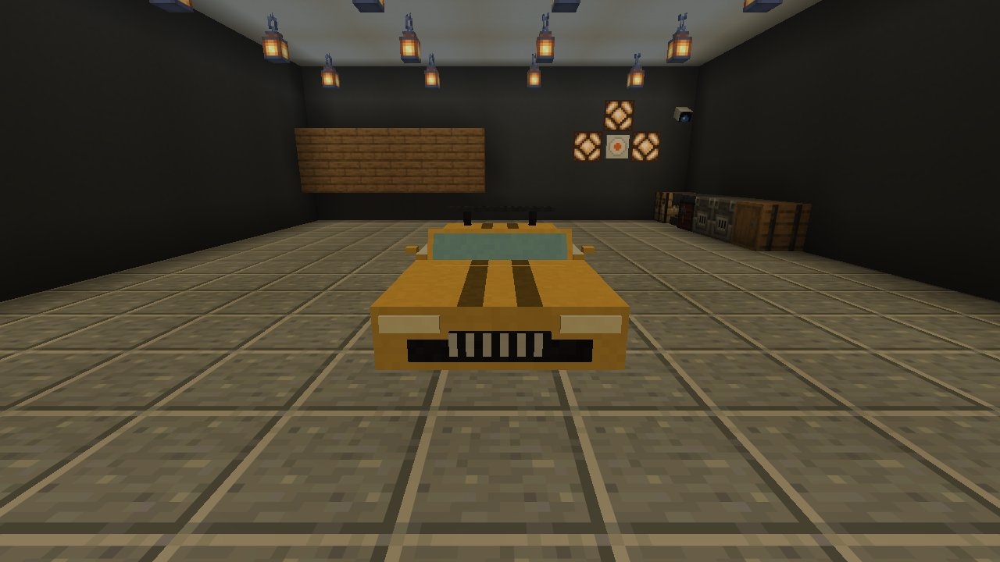

<div align="center">


[](https://github.com/MoinMornhart/Minecraft-aber-du-bist-stinkend-Reich/releases/latest)
[](#-installation)
[](https://fabricmc.net/)

### Jede neue Welt beginnt in deiner eigenen Luxusvilla –<br>mit Butler James und einem goldenen Bonzenauto in der Garage.

[**⬇️ Herunterladen**](https://github.com/MoinMornhart/Minecraft-aber-du-bist-stinkend-Reich/releases/latest) &nbsp;·&nbsp;
[Installation](#-installation) &nbsp;·&nbsp;
[Villa](#️-die-villa) &nbsp;·&nbsp;
[Butler](#-butler-james) &nbsp;·&nbsp;
[Bonzenauto](#️-das-bonzenauto) &nbsp;·&nbsp;
[Einstellungen](#️-einstellungen)

</div>

<br>


## 🏛️ Die Villa

In **jeder neuen Welt** steht am Spawn deine Villa – egal welcher Welttyp. Das Gelände drumherum wird geebnet und weich an die Landschaft angeblendet. Du startest vor dem Tor, mit der Zugangskarte in der Tasche. Bestehende Welten bleiben unberührt.

Wassergraben mit Brücke · zwei Glaskuppel-Brunnen · Pool mit Abdeckung · Garten mit Grillecke · drei Etagen · Penthouse mit Whirlpool auf dem Dach · Garage · Untergrundbunker.

<table>
<tr>
<td width="50%"><br><sub><b>Von vorn:</b> roter Teppich bis zur Haustür</sub></td>
<td width="50%"><br><sub><b>Abends:</b> Sonnenuntergang über dem Anwesen</sub></td>
</tr>
<tr>
<td><br><sub><b>Nachts:</b> alles beleuchtet</sub></td>
<td><br><sub><b>Dachterrasse:</b> Whirlpool mit Ausblick</sub></td>
</tr>
</table>

### 🔐 29 Mechanismen – alles eigene Blöcke

<table>
<tr>
<td width="33%"><br><sub><b>Schmuck-Tresor</b> mit Lasern, Fallen und versteckten Entschärfknöpfen</sub></td>
<td width="33%"><br><sub><b>Tresortür</b> mit Tastenfeld und Kartenleser</sub></td>
<td width="33%"><br><sub><b>Laserschranken</b> im Bunkergang</sub></td>
</tr>
<tr>
<td><br><sub><b>Sicherheitszentrale:</b> Stufe 0 bis 3</sub></td>
<td><br><sub><b>Überwachung:</b> acht Kameras am Monitor</sub></td>
<td><br><sub><b>Aufzug</b> zu allen Etagen und in den Bunker</sub></td>
</tr>
</table>

| Bereich | Was drin ist |
|---|---|
| 🚨 **Sicherheit** | Sicherheitsstufen 0–3 · Laserschranken · Bewegungsmelder · Sirenen · Warnleuchten · Alarm im Chat |
| 🪪 **Zugang** | Zugangskarte · Kartenleser · Tastenfeld mit eigenem Code · automatische Tore · Rollläden · Schiebetüren |
| 🛗 **Im Haus** | Aufzug zu allen Etagen und in den Bunker · Überwachungsraum mit Kameras · Geheimgang hinter dem Bücherregal · Panikraum · Fluchttunnel |
| 💎 **Tresor** | Schmuck-Tresor mit Fallen und versteckten Entschärfknöpfen |
| 🛁 **Komfort** | Poolabdeckung · Whirlpool · Kamin · Garagentor |

Alles funktioniert für jeden Spieler – auch auf einem Server mit Freunden.

<br>

## 🤵 Butler James

James wartet in der Halle, folgt dir auf Wunsch oder bleibt zu Hause. Er **erledigt echte Arbeit**: gräbt sich selbst Tunnel zum Erz, baut ab, schmilzt im Hochofen, fällt Bäume und pflanzt nach, jagt, kocht, stellt Dinge her, sortiert Truhen – und bringt dir alles oder legt es in die Lieferkiste. An der Villa und an deinen Bauten baut er **nie** etwas ab.

<table>
<tr>
<td width="33%"><br><sub><b>James</b> in der Halle</sub></td>
<td width="33%"><br><sub><b>Rechtsklick:</b> Menü mit Knöpfen und Textfeld</sub></td>
<td width="33%"><br><sub><b>Unterwegs</b> zum nächsten Erz</sub></td>
</tr>
</table>

Sprich ihn im Chat an – mit „Butler“ oder seinem Namen –, nimm `/butler …` oder klick ihn an. Schleichen + Rechtsklick öffnet seine Taschen.

| Du sagst | James … |
|---|---|
| `Butler, hol mir 32 Eisen` | sucht Eisenerz, gräbt sich hin, baut ab, schmilzt es im Hochofen und bringt dir 32 Eisenbarren |
| `Butler, hol 20 rohes Eisen in die Truhe` | wie oben, aber ungeschmolzen und in die Lieferkiste in der Halle |
| `Butler, fäll 32 Holz` | fällt natürliche Bäume und pflanzt neue Setzlinge |
| `Butler, mach 16 Fackeln` | holt selbst Holz und Kohle, macht Bretter, Stöcke und Fackeln |
| `Butler, hol Essen` · `koch was` | nimmt Essen aus der Speisekammer, sonst jagt und brät er |
| `Butler, sortier die Truhen` | räumt alle Truhen und Fässer in deiner Nähe auf, jede Sorte in ihre Truhe |
| `folg mir` · `bleib hier` · `geh nach Hause` · `komm her` · `stopp` · `hilfe` | genau das |

Außerdem: `/butler rufen` holt ihn herbei (oder stellt dir einen eigenen ein), `/butler truhe` macht die angeschaute Truhe zu seiner Lieferkiste, und das **Butler-Glöckchen** ruft ihn auch.

> [!TIP]
> **Mit Claude (freiwillig):** Trag in `config/stinkendreich.json` unter `anthropicApiKey` deinen Schlüssel von [console.anthropic.com](https://console.anthropic.com) ein. Dann versteht James auch freie Sätze wie „Ich brauche Licht für meine Mine“ und antwortet selbst. Der Schlüssel bleibt auf deinem Rechner.

<br>

## 🏎️ Das Bonzenauto


Ein goldenes Sportcabrio mit vier Sitzen wartet in der Garage: Gas mit Trägheit, Bremse und Rückwärtsgang, Driften mit der Handbremse, Steigungen, Scheinwerfer mit echtem Licht, Hupe, Tacho, drei Kameraarten und acht Lackfarben.

<table>
<tr>
<td width="33%"><br><sub><b>In der Garage</b> – bereit zur Ausfahrt</sub></td>
<td width="33%"><br><sub><b>Drift</b> mit Reifenqualm</sub></td>
<td width="33%"><br><sub><b>Fuhrpark:</b> mit Farbstoff umlackieren</sub></td>
</tr>
</table>

| Taste | |
|---|---|
| **Rechtsklick** | einsteigen (bis zu vier Leute) · **Schleichen:** aussteigen |
| **W / S** | Gas / Bremse und Rückwärtsgang |
| **A / D** | lenken (bei hohem Tempo weniger Einschlag) |
| **Leertaste** | Handbremse – in der Kurve zum Driften |
| **H** | Hupe |
| **G** | Scheinwerfer (leuchten wirklich) |
| **V** | Kamera: Verfolger · Fahrersicht · Verfolger weit |

Lackfarben: Schwarz, Weiß, Rot, Gelb, Gold, Blau, Grün, Pink – einfach mit dem passenden Farbstoff anklicken. Schleichen + Rechtsklick mit leerer Hand packt das Auto ein.

<br>

## 📦 Installation

1. [Fabric Loader](https://fabricmc.net/use/installer/) für deine Minecraft-Version installieren.
2. [Fabric API](https://modrinth.com/mod/fabric-api) **für dieselbe Version** in den `mods`-Ordner legen.
3. Aus dem [neuesten Release](https://github.com/MoinMornhart/Minecraft-aber-du-bist-stinkend-Reich/releases/latest) die passende `.jar` nehmen (Tabelle unten) und ebenfalls in `mods` legen.
4. **Neue Welt** erstellen – du stehst vor dem Tor deiner Villa.

> [!IMPORTANT]
> Jede Datei passt **nur zu genau einer** Minecraft-Version. Die Version steht im Launcher neben „Spielen“ und im Spiel unten links im Hauptmenü. Erscheint beim Start „Incompatible mods found“, liegt die Datei für eine andere Version im `mods`-Ordner.

| Deine Minecraft-Version | Diese Datei nehmen |
|---|---|
| 26.3 | `stinkendreich-…+mc26.3.jar` |
| 26.2 | `stinkendreich-…+mc26.2.jar` |
| 26.1 · 26.1.1 · 26.1.2 | `stinkendreich-…+mc26.1.jar` · `+mc26.1.1.jar` · `+mc26.1.2.jar` |
| 1.21.11 · 1.21.10 · 1.21.9 | `stinkendreich-…+mc1.21.11.jar` · `+mc1.21.10.jar` · `+mc1.21.9.jar` |
| 1.21.8 bis 1.21.1 | `stinkendreich-…+mc1.21.8.jar` … `+mc1.21.1.jar` |
| 1.21 | `stinkendreich-…+mc1.21.jar` |

Die Zahl hinter `+mc` muss **genau** deiner Version entsprechen. 1.21 bis 1.21.11 brauchen Java 21, 26.x braucht Java 25 (der offizielle Launcher bringt das passende Java mit).

<br>

## ⚙️ Einstellungen

Alle Einstellungen stehen mit Erklärung in `config/stinkendreich.json`, unter anderem: Villa an/aus, Breite der Anblendung, Name und Arbeitstempo des Butlers, Suchradius, Jagen erlaubt, Höchstgeschwindigkeit des Autos und die Update-Prüfung.

## 🔄 Updates

Beim Start schaut die Mod in den Releases dieses Projekts nach einer neueren Version **für deine Minecraft-Version**. Gibt es eine, steht im Chat „Neue Version … ist da“ mit **[Herunterladen]** und **[Release-Seite]**. Nach dem Herunterladen wird die neue Datei beim Beenden von Minecraft eingespielt.

<details>
<summary><b>🛠️ Selbst bauen</b></summary>

<br>

```bash
./gradlew buildAndCollect          # alle Versionen, Ergebnis in build/libs/<version>/
./gradlew :1.21.4:buildAndCollect  # nur eine Version
```

Eine Codebasis für alle Versionen mit [Stonecutter](https://stonecutter.kikugie.dev/); Unterschiede stehen als `//?`-Bedingungen im Code. Die Villa entsteht aus `tools/villa/villa.py`, Texturen, Geräusche, Icon und Titelbild aus `tools/assets/`. `tools/ingame/test.sh` startet Minecraft ohne Grafikkarte und macht Screenshots; die Fotos dieser Seite stammen aus `tools/ingame/szenarien/fotos.txt`.

**Neues Release:** `mod.version` in `stonecutter.properties.toml` erhöhen, dieselbe Nummer in `.github/release-version` eintragen und pushen (oder ein Tag `v…` pushen). GitHub baut dann alle .jar und legt das Release an; die Update-Funktion der Mod findet es von selbst.

</details>

## ⚖️ Hinweis zur Villa

Die Villa ist ein eigener Entwurf im Stil der „Super Safe Modern Mansion“ von chamo572. Die Original-Map ist weder in diesem Repo noch in den Releases enthalten. Nur zur privaten Nutzung.

---

<div align="center">

<br>
<sub>Verfasst mit Claude 🤖</sub>
</div>
