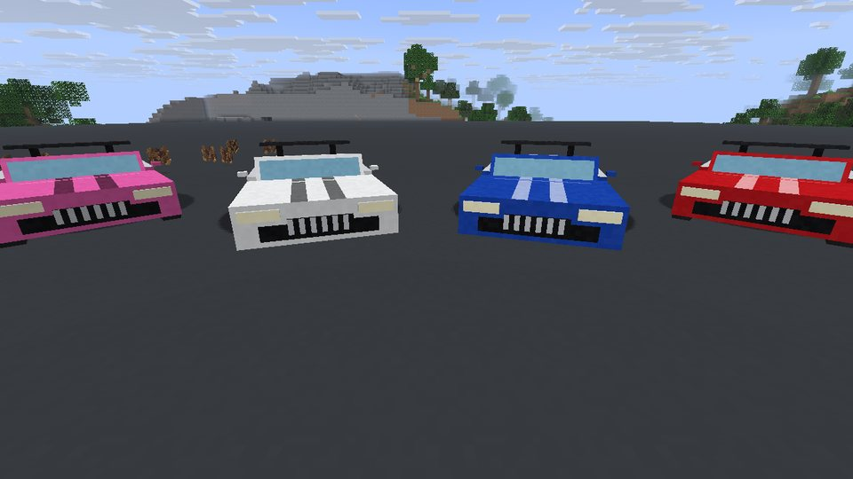

<div align="center">

# 💰 Minecraft, aber du bist stinkend reich

**Jede neue Welt beginnt in deiner eigenen Luxusvilla – mit Butler und Bonzenauto in der Garage.**


</div>

## 📸 So sieht es aus

<table>
<tr>
<td><br><sub>Die Villa am Spawn</sub></td>
<td><br><sub>Schmuck-Tresor mit Lasern</sub></td>
</tr>
<tr>
<td><br><sub>Butler James in der Halle</sub></td>
<td><br><sub>Sein Menü (Rechtsklick)</sub></td>
</tr>
<tr>
<td><br><sub>Drift mit dem Bonzenauto</sub></td>
<td><br><sub>Vier der acht Lackfarben</sub></td>
</tr>
</table>

## ✨ Was die Mod macht

| | Funktion | Kurz |
|---|---|---|
| 🏛️ | **Villa am Spawn** | In jeder neuen Welt steht am Spawn eine moderne Hochsicherheits-Villa: Wassergraben, Brücke, Pool, Garten, drei Etagen, Penthouse mit Whirlpool, Bunker, Garage. Das Gelände wird geebnet und weich angeblendet. Bestehende Welten bleiben unberührt. |
| 🔐 | **29 Mechanismen** | Sicherheitsstufen 0–3 mit Lasern, Bewegungsmeldern, Sirenen und Warnleuchten · Zugangskarte, Kartenleser, Tastenfeld · automatische Tore, Rollläden, Schiebetüren · Aufzug zu allen Etagen und in den Bunker · Schmuck-Tresor mit Fallen und versteckten Entschärfknöpfen · Überwachungsraum mit Kameras · Geheimgang, Panikraum, Fluchttunnel · Poolabdeckung, Whirlpool, Kamin. Alles eigene Blöcke, funktioniert für jeden Spieler. |
| 🤵 | **Butler** | Wartet in der Halle, folgt dir oder bleibt zu Hause. Holt Erze (gräbt selbst Tunnel), fällt Bäume, jagt, schmilzt im Ofen, kocht, stellt Dinge her, sortiert Truhen und bringt dir alles – oder legt es in die Lieferkiste. Baut nie etwas an der Villa oder an deinen Bauten ab. Optional mit Claude. |
| 🏎️ | **Bonzenauto** | Goldenes Sportcabrio mit vier Sitzen in der Garage: Gas mit Trägheit, Bremse, Rückwärtsgang, Driften mit der Handbremse, Steigungen, Scheinwerfer mit echtem Licht, Hupe, Tacho, drei Kameraarten, acht Lackfarben. |
| 🔄 | **Update-Funktion** | Beim Start schaut die Mod in den GitHub-Releases nach einer neueren Version für deine Minecraft-Version und bietet sie im Chat an. |

## 📦 Installation

1. [Fabric Loader](https://fabricmc.net/use/installer/) für deine Minecraft-Version installieren.
2. [Fabric API](https://modrinth.com/mod/fabric-api) in den `mods`-Ordner legen.
3. Aus den [Releases](https://github.com/MoinMornhart/Minecraft-aber-du-bist-stinkend-Reich/releases) die `.jar` nehmen, deren Name zu deiner Version passt, z. B. `stinkendreich-0.1.0+mc1.21.4.jar`, und ebenfalls in `mods` legen.
4. Neue Welt erstellen. Du stehst vor dem Tor deiner Villa und hast eine Zugangskarte in der Tasche.

Unterstützt: 1.21, 1.21.1 bis 1.21.11 (Java 21) und 26.1, 26.1.1, 26.1.2, 26.2, 26.3 (Java 25).

## 🤵 Den Butler steuern

Sprich ihn im Chat an – mit „Butler“ oder seinem Namen –, nimm `/butler …`, oder klick ihn an (Menü mit Knöpfen und Textfeld). Schleichen + Rechtsklick öffnet seine Taschen.

| Du sagst | Er tut |
|---|---|
| `Butler, hol mir 32 Eisen` | sucht Eisenerz, gräbt sich hin, baut ab, schmilzt es im Hochofen und bringt dir 32 Eisenbarren |
| `Butler, hol 20 rohes Eisen in die Truhe` | wie oben, aber ungeschmolzen und in die Lieferkiste in der Halle |
| `Butler, fäll 32 Holz` | fällt natürliche Bäume und pflanzt neue Setzlinge |
| `Butler, mach 16 Fackeln` | holt selbst Holz und Kohle, macht Bretter, Stöcke und Fackeln |
| `Butler, hol Essen` / `koch was` | nimmt Essen aus der Speisekammer, sonst jagt und brät er |
| `Butler, sortier die Truhen` | räumt alle Truhen und Fässer in deiner Nähe auf |
| `folg mir` · `bleib hier` · `geh nach Hause` · `komm her` · `stopp` · `hilfe` | genau das |

Weitere Befehle: `/butler rufen` (holt ihn herbei oder stellt dir einen eigenen ein), `/butler truhe` (die angeschaute Truhe wird seine Lieferkiste). Das **Butler-Glöckchen** ruft ihn auch.

**Mit Claude (optional):** Trag in `config/stinkendreich.json` unter `anthropicApiKey` deinen Schlüssel von [console.anthropic.com](https://console.anthropic.com) ein. Dann versteht der Butler freie Sätze („Ich brauche Licht für meine Mine“) und antwortet selbst. Der Schlüssel bleibt auf deinem Rechner.

## 🏎️ Das Bonzenauto fahren

Rechtsklick aufs Auto zum Einsteigen (bis zu vier Leute), Schleichen zum Aussteigen.

| Taste | |
|---|---|
| **W / S** | Gas / Bremse und Rückwärtsgang |
| **A / D** | Lenken (bei hohem Tempo weniger Einschlag) |
| **Leertaste** | Handbremse – in der Kurve zum Driften |
| **H** | Hupe |
| **G** | Scheinwerfer (leuchten wirklich) |
| **V** | Kamera: Verfolger · Fahrersicht · Verfolger weit |

Mit Farbstoff umlackieren (Schwarz, Weiß, Rot, Gelb, Gold, Blau, Grün, Pink). Schleichen + Rechtsklick mit leerer Hand packt das Auto ein.

## ⚙️ Einstellungen

Alle Einstellungen stehen mit Erklärung in `config/stinkendreich.json`, unter anderem: Villa an/aus, Breite der Anblendung, Name und Arbeitstempo des Butlers, Suchradius, Jagen erlaubt, Höchstgeschwindigkeit des Autos, Update-Prüfung.

## 🛠️ Selbst bauen

```bash
./gradlew buildAndCollect          # alle Versionen, Ergebnis in build/libs/<version>/
./gradlew :1.21.4:buildAndCollect  # nur eine Version
```

Eine Codebasis für alle Versionen mit [Stonecutter](https://stonecutter.kikugie.dev/); Unterschiede stehen als `//?`-Bedingungen im Code. Die Villa entsteht aus `tools/villa/villa.py`, Texturen und Geräusche aus `tools/assets/`. `tools/ingame/test.sh` startet Minecraft ohne Grafikkarte und macht Screenshots.

**Neues Release:** `mod.version` in `stonecutter.properties.toml` erhöhen, dieselbe Nummer in `.github/release-version` eintragen und pushen (oder ein Tag `v…` pushen). GitHub baut dann alle .jar und legt das Release an; die Update-Funktion der Mod findet es von selbst.

## ⚖️ Hinweis zur Villa

Die Villa ist ein eigener Entwurf im Stil der „Super Safe Modern Mansion“ von chamo572. Die Original-Map ist weder in diesem Repo noch in den Releases enthalten.

---

<sub>Verfasst mit Claude 🤖</sub>
